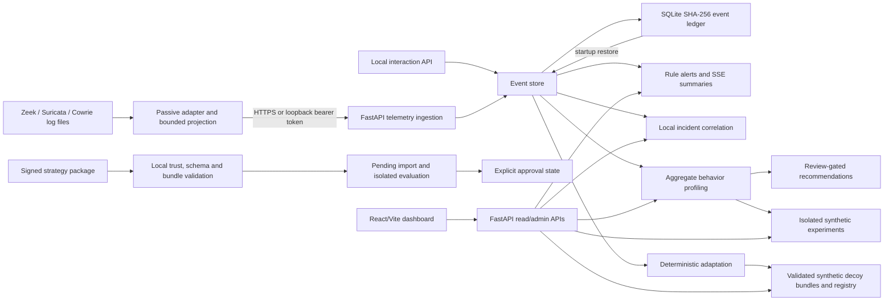

# Architecture

## Persistence boundaries

The event ledger, decoy registry, adaptation history, simulations/evaluations,
incidents, profiles/recommendations, experiments, and strategy-sharing imports
use separate local SQLite stores. Incident/profile/experiment/sharing stores
are initialized lazily by their storage objects; the event ledger and
checkpoint service currently initialize during application module import.
Tests must therefore run against a temporary source copy. The ledger hash
chain is local integrity evidence. It is not replicated consensus.

## Processing paths

1. A synthetic interaction is validated and stored in the ledger, then made
   available to in-process fingerprint/adaptation services.
2. A log adapter parses and bounds a source record, derives a stable event ID,
   and posts it to the token-protected normalized ingestion route.
3. Ingestion deduplicates, persists to the event ledger, then publishes
   redacted live event/alert/incident hints. Correlation and profile features
   use selected event fields, not executable payloads.
4. Local experiments use their own event and incident state. Strategy sharing
   verifies a signed sanitized template, stores it pending, evaluates locally,
   and requires an explicit approval action. Approval is not automatic
   enforcement.

The organization replication unit tests use in-process node objects, generated
test keys, explicit trust, and separate temporary storage paths. The live demo
and its integration test start two independent Uvicorn processes with separate
SQLite stores and Ed25519 keys, exchange signed records over localhost HTTP,
and exercise duplicate, tamper, downtime, and restart behavior. This remains a
controlled local prototype: it does not implement consensus, quorum, or
Byzantine fault tolerance, and it has not been verified across machines.
